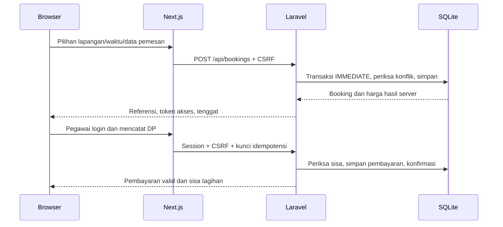

# Panduan belajar proses pengembangan Lola Sport

## Hubungan komponen

Frontend adalah tampilan yang berinteraksi dengan pengguna. Backend menerima permintaan, memeriksa identitas/kewenangan, menjalankan aturan, lalu membaca atau menyimpan database. Database mempertahankan catatan setelah proses aplikasi berhenti. Git menyimpan versi kode; hosting menjalankan versi tersebut pada mesin yang dapat diakses pengguna. Push kode sendiri tidak menjalankan aplikasi online.

## A — Pemetaan kebutuhan

Dibuat daftar penerimaan dan pemisahan antara PRD draft, asumsi demo, dan keputusan pengelola. File utama: `docs/PRD.md`, `docs/prototype-decisions.md`. Periksa bahwa nilai contoh tidak tertulis sebagai tarif resmi. Kegagalan yang dicegah: menganggap kode sebagai persetujuan bisnis. Dalam tim profesional, analis/pengelola meninjau kebutuhan; agen tidak dapat menggantikan persetujuan mereka.

## B — Fondasi

Laravel berada di `backend`, Next.js di `frontend`. Migration mendefinisikan bentuk database: lapangan, booking, pembayaran, dan pengguna. Seeder mengisi lapangan contoh, tanpa akun/password bawaan. Akun dibuat melalui `lola:admin`. Jalankan setup, periksa empat lapangan, lalu login/logout. Session menyimpan identitas login; cookie HttpOnly dikirim browser dan CSRF mengurangi risiko tindakan tanpa izin dari situs lain. Middleware `AdminOnly` memeriksa kewenangan di server. Review independen atas keamanan masih diperlukan sebelum bisnis nyata.

## C — Booking sampai lunas

`BookingService` menjadi pusat perhitungan dan penyimpanan. `BookingForm` menangani formulir; `BookingDetails` menampilkan status; `AdminDashboard` mencatat transaksi. Coba panduan README, kemudian kirim nominal berlebih: server harus menolak. Tarif dan total disalin ke booking supaya harga lama tidak berubah saat tarif lapangan berubah. Dalam tim, perubahan frontend/backend perlu dikoordinasikan melalui kontrak API dan review perubahan.

## D — Pelengkap operasional

Jadwal WA/onsite menggunakan layanan booking yang sama. Pending kedaluwarsa langsung dianggap tidak aktif. Pembatalan unpaid melepas slot dan menyimpan riwayat. Rekap menjumlahkan catatan pembayaran sesuai batas tanggal Jakarta. Periksa jumlah contoh secara terpisah; jangan menjumlahkan nilai booking sekali lagi. Kebijakan refund/reschedule tetap memerlukan keputusan manusia.

## E — Verifikasi

Pengujian otomatis adalah langkah yang memeriksa perilaku berulang dan gagal bila hasil berubah. `BookingFlowTest` memeriksa fungsi melalui API; `ConcurrencyTest` memeriksa dua proses database bersama; Playwright memeriksa tindakan melalui browser. Lint mencari masalah kode; typecheck memeriksa kesesuaian tipe; build menyiapkan keluaran aplikasi. Build sukses saja tidak membuktikan booking benar. Hasil dan batas bukti dicatat di status implementasi. Pengujian agen adalah pemeriksaan internal, bukan UAT atau review independen.

## F — Persiapan staging

Staging adalah lingkungan latihan/evaluasi yang dipisahkan dari operasional. Lihat `docs/staging.md` untuk proses PHP-FPM, Next.js, HTTPS dan disk persisten. Branch khusus dapat dipush dan diajukan sebagai draft PR, yaitu usulan perubahan yang belum siap digabung tanpa pemeriksaan. CI menjalankan pemeriksaan setelah perubahan dikirim; hasil remote harus dibaca sebelum dinyatakan lulus. Pemilik akses hosting menentukan deployment dan rilis.

## Latihan setelah aplikasi selesai

1. Buat booking bersebelahan, lalu coba booking bertumpang tindih. Jelaskan kenapa hasilnya berbeda.
2. Catat DP dan pelunasan; cocokkan total dua pembayaran dengan sisa tagihan dan rekap.
3. Buat booking melalui pegawai dan lihat jadwal publik: identitas pemesan harus tetap tersembunyi.
4. Pelajari satu test, ubah data uji pada branch latihan, dan jalankan lagi. Jangan mengubah assertion agar kegagalan hilang.
5. Buat issue yang menyebut kebutuhan PRD, langkah reproduksi, hasil harapan/aktual, dan bukti tanpa token/kredensial.

Untuk proposal Waterfall, bedakan keluaran tahap yang sudah dibuat dengan kegiatan validasi kebutuhan, evaluasi pengguna, dan keputusan penerapan yang masih perlu dilaksanakan kelompok.

## Pembaruan Tahap 1 v2 — satu lapis demi satu lapis

1. **Kebutuhan:** `requirements-v2.md` memberi ID, asal dan status informasi. Tarif futsal dari pembahasan melalui pengguna dibedakan dari pilihan sementara badminton dan batas 60 menit. PRD menerima addendum, tanpa mengubah proposal atau memberi persetujuan bisnis.
2. **Data:** migration hanya menambah kolom nullable. Seeder mengisi data baru; command tarif menampilkan preview dan hanya memperbarui ID yang ditinjau dengan guard nilai lama. Harga/DP booking adalah snapshot; memperbarui lapangan tidak mengubah piutang lama. `LegacyUpgradeTest` memeriksa file SQLite sementara.
3. **Aturan server:** jam tutup 24 berarti awal tanggal berikutnya. DP, syarat mendadak dan deadline dihitung pada transaksi server. `BusinessClock` menyediakan waktu aturan yang bisa diuji tanpa mengubah jam laptop; tidak menambah pengubah waktu pada aplikasi biasa.
4. **Pembayaran:** frontend memilih jenis; server menentukan nominal. `expected_amount` mendeteksi tampilan lama, bukan menentukan uang diterima. Pelunasan selalu sisa. Kunci idempotensi mengidentifikasi request yang sama, bukan transfer nyata yang sama.
5. **Antarmuka:** `BookingForm` memberi tanggal cepat/penjelasan DP, `PaymentForm` memberi tinjauan, dan `BookingDetails` memisahkan reservasi, pembayaran dan mulai bermain. Rincian ponsel difokuskan setelah pemilihan; referensi dan batas pemeriksaan ada di `design-notes-v2.md`.
6. **Prosedur pegawai:** mulai bermain memeriksa tagihan dan waktu, lalu menyimpan pelaku/waktu sekali. Jam lewat bukan kehadiran; catatan tidak mengendalikan akses fisik.
7. **Verifikasi/setup:** CI Windows awal gagal karena fileinfo tidak aktif. Perbaikannya mengaktifkan ekstensi dan memeriksa runtime sebelum Composer. Browser memakai jam bisnis/database terpisah, sementara CSRF/session tetap diuji.

Latihan: pesan tiga jam dan bandingkan DP dengan satu jam; coba 23.00 satu jam versus dua jam; jalankan preview tarif tanpa apply; setelah DP klik mulai, lalu lunasi dan tandai mulai pada rentang jadwal. Untuk alur otomatis tanpa menunggu, gunakan E2E terisolasi. Tahap 2 tetap rancangan: jangan memasukkan angka kandidat ke config sebelum keputusan dicatat.
